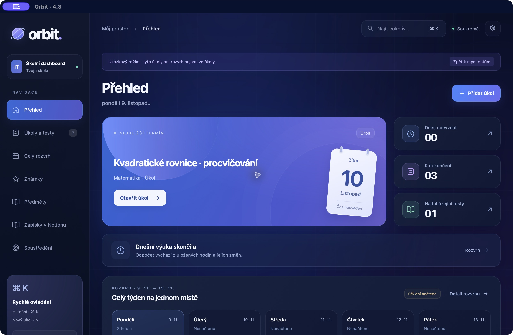

<h1 align="center">Orbit</h1>

<strong>Osobní školní dashboard</strong> Úkoly, rozvrh, známky a soustředění. Tvoje škola na jednom místě.

Experimentální veřejná verze 4.3 · zdarma · bez přibalených účtů a osobních dat

Náhled používá pouze ukázkové úkoly a rozvrh.

## Stáhnout a spustit

1. Klikni na **Stáhnout pro Mac** a rozbal stažený ZIP.
2. Přesuň **Orbit.app** do složky **Applications / Aplikace** a otevři ji.
3. Přidej si vlastní úkoly, hodiny a předměty. V **Nastavení → Otevřít ukázkový režim** si můžeš vše nejdřív prohlédnout.

**Mac verze je pro čipy M1, M2, M3, M4, M5 a další Apple silicon, s macOS 14 nebo novějším.** Sestavení není notarizované Applem. Pokud macOS spuštění zablokuje, použij verzi do prohlížeče.

**Verze do prohlížeče:** rozbal ZIP a dvojklikem otevři **Orbit.html** v Chromu nebo Safari. Není potřeba instalace, Git ani programování. Prohlížečová verze nepodporuje přímou synchronizaci EduPage.

[Zobrazit všechny soubory ke stažení a poznámky k verzi →](https://github.com/AjtakDan/osobni-skolni-dashboard/releases/tag/v4.3.0-preview.1)

## Co v Orbitu najdeš

- **Úkoly a testy** – termíny, priority a přehled toho, co zbývá dokončit.
- **Rozvrh a předměty** – vlastní hodiny, poznámky a odkazy k výuce.
- **Známky** – ruční evidence a přehled průměrů.
- **Soustředění** – časovač na 25, 45 nebo 60 minut.
- **Zálohy** – export a obnova vlastních dat v Nastavení.

## Školní účty a synchronizace

**Stažená verze funguje jako samostatný organizér s ručním zadáváním.** Neobsahuje připojený školní účet. Vyplnění e-mailu v Nastavení samo o sobě nepropojí školní služby.

Automatická synchronizace EduPage v této veřejné šabloně vyžaduje vlastní lokální konfiguraci a sestavení podle [technického postupu](docs/DEVELOPMENT.md). Automatický přenos z Classroom ani obsahová synchronizace Notion zatím nejsou dokončené. Nejde o univerzální instalátor se zaručeným propojením každé školy.

Data se ukládají na tvém zařízení. Mezi zařízeními ani prohlížeči se automaticky nepřenášejí; pro přenos používej zálohu. Veřejný náhled a stažené balíčky neobsahují skutečné školní údaje.

## Pro vývojáře

[Zdrojový kód, vlastní sestavení, testy a známá omezení →](docs/DEVELOPMENT.md)

## Licence

Projekt je dostupný pod [GPL-3.0-or-later](LICENSE). [Oznámení k závislostem](THIRD_PARTY_NOTICES.md). Orbit je nezávislý projekt; není oficiální aplikací EduPage ani Google.
